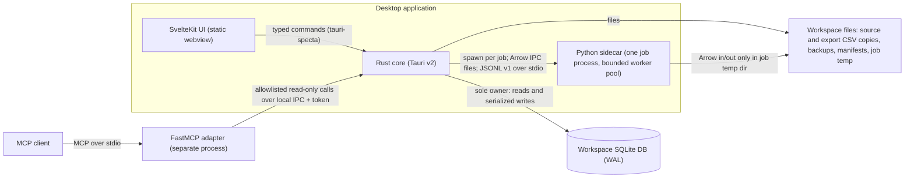

# System Architecture — OpenDemand

Scope: the component structure, process boundaries, contracts, job lifecycles, and failure behavior of the OpenDemand desktop application. Decision rationale lives in the ADRs; data semantics live in `DATA_ARCHITECTURE.md`; the schema lives in `schema/001_init.sql`.

## 1. Components and Data Flow

- The **SvelteKit UI** is a presentation layer: it renders state and sends typed commands. It has no filesystem or database access.
- The **Rust core** is the only component that opens the workspace database, validates data, orchestrates jobs, creates backups, and writes exports (ADR-0002).
- The **Python sidecar** runs one job process per forecast job, exchanging Arrow IPC files and JSONL v1 control messages (ADR-0003). For expensive model fitting it runs a bounded pool of short-lived worker processes inside that job (ADR-0018); workers only fit and predict. It never opens the database.
- The **FastMCP adapter** is a separate process speaking MCP over stdio to a client; it reaches data only through allowlisted read-only calls to the core over local IPC (ADR-0010).
- The **workspace directory** contains the SQLite database, retained source CSV copies, exported CSV copies, backups with manifests, and the job temp area.

## 2. Process and Trust Boundaries

| Boundary | Trust level | Constraints |
|----------|-------------|-------------|
| Webview UI | Untrusted presentation | No FS/DB access; typed commands only; all rendering from command results |
| Rust core | Trusted | Sole DB owner; applies pragmas; single serialized writer; owns validation and job orchestration |
| Sidecar process | Trusted code, crash-isolated | One job process per job; a bounded worker pool inside it only fits and predicts (ADR-0018); no DB access; reads/writes only its job temp dir; bounded lifetime per job |
| MCP adapter | Restricted | Read-only; local IPC + per-session token; fixed workspace; allowlisted tools; paginated results; audited |
| MCP client | External, untrusted | Sees only allowlisted read-only data for the selected workspace |
| Source CSV files | Untrusted input | Parsed and validated at import; encoding and schema checks fail closed |

## 3. IPC Contracts

### 3.1 Command Surface (design level)

The commands, results, and errors implemented through Milestone 2 are defined in `contracts/TAURI_IPC.md`; the list below is the full capability set (later phases included). Final names are generated by `tauri-specta` at implementation:

- Workspace: `open`, `create`, `close`, `info`, `settings_get`, `settings_set`, `timezone_set`
- Source profiles: `list`, `create`, `update`, `activate`
- Mappings: `list`, `upsert`, `delete`, `unmapped_report`
- Import: `start`, `cancel`, `list_revisions`, `revision_detail`, `issues`
- Data: `search_products`, `series_history`, `quality_summary`
- Forecast: `start`, `cancel`, `status`, `list_runs`, `run_detail`, `run_series`
- Overrides: `list`, `append`, `clear`
- Export: `start`, `cancel`, `list_exports`
- Backup: `create`, `verify`, `list`, `prune`
- Jobs: `list`, `cancel`
- MCP: `status`, `enable`, `disable`

Concurrency rules: exactly one forecast job at a time. Imports may run while a forecast is running because import revisions are immutable and a forecast run pins its revision id; all database writes still serialize through the single writer.

### 3.2 Sidecar Control Protocol (JSONL v1)

- Transport: stdin/stdout, one JSON object per line, UTF-8; stdout is protocol-only and logs go to stderr. Protocol id `opendemand.sidecar/1`.
- Exchange: `hello` (engine version, supported contract versions, supported models) → one `job.request` (job id, task contract version, fixed relative input file names) → `job.progress` (phase: `validate_input`, `backtest`, `production`, `write_output`) → one terminal `job.result` (output file names, row counts, SHA-256 values), `job.error` (stable code, message, retryable), or `job.cancelled`.
- Rules: unknown message type or protocol mismatch fails the job with a user-correctable error; heartbeat at most 30 seconds apart; 5-second hello timeout; configurable job timeout (30 minutes default); cancellation by a `cancel.flag` file in the job directory (stdin carries only `job.request` and is closed after it, ADR-0016) followed by a 5-second grace, then the process is killed and reaped; a job timeout uses the same flag-and-grace stop so a running worker pool shuts down before the kill; at most one whole-job retry for `engine_start_failed` or `unexpected_eof` before output is accepted; contract/input errors, timeouts, and cancellations are never retried.
- Exact envelopes, error codes, and file-name rules: `contracts/SIDECAR_PROTOCOL.md`.

### 3.3 Arrow IPC Data Contract

Arrow IPC files carry `opendemand.contract=opendemand.arrow/1` and `opendemand.table` metadata; both sides validate schema and metadata before use, and mismatches fail the job.

- Rust inputs: `observations.arrow` (series ids, Monday week, nullable quantity, observation status) and `tasks.arrow` (one row per planned production/backtest task with task id, series, model, kind, nullable origin index, train window, forecast start, and the fixed 12-week horizon).
- Python outputs: `task_status.arrow` (one row per task, `completed | failed`, failure code/detail), `origin_metrics.arrow` (per-series/model/origin WAPE, MAE, metric kind/value, origin date, train size), and `forecast_points.arrow` (12 finite weekly points per completed task).
- Rust validates planned keys, uniqueness, dates, counts, horizon completeness, metric consistency, and file hashes; it derives eligibility rows from its plan, computes selection score/rank, applies champion/fallback policy, and persists all run data in one transaction. Python computes tasks and metrics only and cannot introduce new products, locations, models, or origins (ADR-0012).
- Exact field lists and file names: `contracts/ARROW_SCHEMAS.md`.

## 4. Job Lifecycles

### 4.1 Import

`validating` (encoding, header, canonical contract) → `staging` (parse rows, build the mapping plan, compute the raw-bytes SHA-256, detect duplicates, compute `H` and qualification; stage and fsync the retained copy) → `committing` (serialized transaction: revision, source file record, issues, observations, qualification; atomic rename of the staged file into `sources/<revision_id>/`) → `completed` or `failed`.

- Idempotency: SHA-256 of the raw retained bytes plus the effective mapping fingerprint and contract version per profile; the same content with the same fingerprint is a no-op with an "already imported" result; a changed fingerprint creates a new immutable revision (ADR-0013).
- Failure: nothing is committed; failed attempts live in `job`, never in `import_revision`; a crash may leave recoverable orphan files that startup reconciliation reports or quarantines (ADR-0015).

### 4.2 Forecast

`preparing` (pin revision, compute `horizon_start_week`, write `observations.arrow` and `tasks.arrow`) → `sidecar_running` (spawn, handshake, request) → `validating_output` (schemas, counts, values, hashes) → `persisting` (one transaction: run, run_model, series_model_evaluation, series_model_origin, backtest_forecast, series statuses, baseline forecasts) → `completed`, `failed`, or `cancelled`.

### 4.3 Export

Milestone 2 CSV: `writing` (one read-only WAL snapshot; bounded full-run batches of latest override ?? baseline) → `publishing` (synced temporary files, no-overwrite publication of the selected file and retained `exports/<uuid>.csv` copy) → `completed` or `failed`. The `export_record` and terminal job state commit together after publication. CSV cancellation is not implemented; XLSX remains a later-phase capability.

A hard kill before the database commit can leave orphan export files or hidden temporary files. Export artifact reconciliation is not implemented yet; see R-22 in `RISK_REGISTER.md`.

### 4.4 Cancellation, Timeouts, Crash Handling

- Cancel: control message first; process kill after grace; job marked `cancelled`; temp dir cleaned; no partial rows (persist is one transaction).
- Sidecar crash or hang: job marked `failed`; one bounded retry is allowed; repeated failure surfaces as `model_failure` for affected series when a rerun succeeds partially.
- Core crash: on next start, any `running` jobs are marked `failed (interrupted)`. Committed database state is transactionally consistent, but retained-file state may hold recoverable leftovers; startup reconciliation detects stale staging files, orphan finals, missing committed files, and hash mismatches, quarantines recoverable artifacts, and reports them. It never silently deletes business data, and the file-before-row protocol guarantees that no committed revision references a file that was not durable (ADR-0015).

## 5. Error Taxonomy

| Category | Examples | Handling |
|----------|----------|----------|
| Transient | SQLITE_BUSY beyond timeout, temp file lock, sidecar crash mid-run | Automatic bounded retry (busy); one sidecar retry; then surface |
| User-correctable | Unmapped codes, malformed CSV, unwritable backup path, sidecar binary missing | Blocking dialog with the exact remedy; import issues report |
| Recovery read-only | Backup failed before migration | Workspace opens read-only; resolve backup, then retry migration |
| Fatal | Database corruption, schema newer than app, unsupported platform | Workspace open blocked; guidance to restore from backup or update the app |

## 6. Performance Hypothesis and Benchmark Protocol

All numeric targets are hypotheses (ADR-0011), especially the 10k-SKU forecast target:

| Target | Hypothesis | Validation |
|--------|------------|------------|
| Forecast 10k SKUs × 156 weeks | ≤ 10 min, RSS ≤ 4 GB | Synthetic dataset benchmark, reference host |
| Import 1.56M observations | ≤ 120 s | Same harness, measured with `synchronous=FULL` |
| Cold start | ≤ 3 s | Launch measurement on reference host |
| SKU search p95 | ≤ 300 ms | Query benchmark on 10k products |
| Chart render | ≤ 1 s | UI benchmark on 12-week series |
| Full XLSX export | ≤ 60 s | Export benchmark on a full run |
| Installer size | ≤ 600 MB | CI artifact measurement |

Protocol: synthetic generator (10k × 156), wall-clock + peak RSS on the reference host (4 CPU / 8 GB / SSD), results recorded under `docs/benchmarks/` with pass/fail. Mitigations if a target fails (no schema changes required): fewer backtest windows or models, chunked/batched processing, streaming I/O, bounded parallelism. Progress reporting and cancellation are architecture guarantees independent of these targets.

Milestone 4 applied bounded parallelism (ADR-0018) and measured the result: `docs/benchmarks/2026-10-14-milestone-4-performance.md` records a 3.7x speed-up on the 100/1,000-series cases and a measured 10,000-series run of about 24 minutes. The 10-minute target is therefore documented as unmet: four cores cannot close a nine-fold gap, and the remaining bottleneck is the irreducible per-series AutoETS fit.

## 7. Storage Growth

Summary (full math in `DATA_ARCHITECTURE.md`): one import revision at benchmark scale is ~0.2-0.3 GB (database rows plus the retained CSV copy); weekly imports grow storage ~10-15 GB/year, monthly ~2.5-3.5 GB/year; backup retention keeps the backup pool at roughly ≤ 4x the database size; per-point backtest results add ~150-220 MB per run; aggregates-only mode may omit those points but always keeps series_model_evaluation and series_model_origin so selection stays reproducible. The UI must show a storage report.

## 8. Security and Privacy

- All business data stays local; there are no network listeners in any component.
- MCP is off by default; when enabled it is read-only, token-guarded, workspace-fixed, and audited (ADR-0010).
- Logs must not contain business data beyond identifiers and counts; no secrets are stored in the workspace or logs.
- CSV copies are user business data; backup and retention rules (ADR-0009) govern their lifecycle.

## Related Documents

- ADRs: `adr/README.md` (0001-0016)
- Contracts: `contracts/` (TAURI_IPC, SIDECAR_PROTOCOL, ARROW_SCHEMAS)
- Data model: `DATA_ARCHITECTURE.md`
- Schema: `schema/001_init.sql` (frozen; SHA-256 in `schema/001_init.sha256`)
- Risks: `RISK_REGISTER.md`
